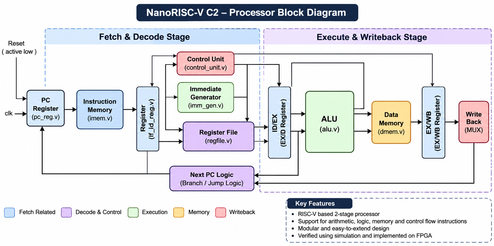

# NanoRISC-V C2
### RISC-V Processor Design Using Verilog HDL

## Overview

NanoRISC-V C2 is a digital hardware design project focused on implementing a RISC-V-based processor using Verilog HDL. The project explores processor architecture, instruction execution, arithmetic and logic operations, memory interfacing, and control flow.

The design is developed and analyzed using AMD/Xilinx Vivado, with simulation and implementation reports used to study its functionality and hardware characteristics.

## Processor Architecture

NanoRISC-V C2 follows a two-stage processor organization consisting of **Fetch & Decode** and **Execute & Writeback** stages. The design integrates instruction fetching, instruction decoding, immediate generation, register-file access, arithmetic and logic operations, memory access, and program-counter control.

The block diagram below illustrates the major processor components and their interconnections.





## Objectives

- Understand the fundamentals of RISC-V processor architecture.
- Implement processor components using Verilog HDL.
- Design arithmetic, logic, memory, and control-flow operations.
- Use simulation testbenches to examine individual modules and processor behavior.
- Analyze FPGA synthesis and timing reports.
- Gain practical experience with digital design and FPGA development tools.

## Instruction Support

The current control logic includes support for the following instruction operations:

| Category | Instructions |
|---|---|
| Arithmetic and Logic | `ADD`, `SUB`, `AND`, `OR`, `XOR`, `SLL`, `SRL` |
| Immediate Operations | `ADDI` |
| Memory Operations | `LW`, `SW` |
| Conditional Branches | `BEQ`, `BNE` |
| Jump | `JAL` |
| Upper Immediate | `LUI` |

## Tools and Technologies

- **Hardware Description Language:** Verilog HDL
- **Design and Simulation:** AMD/Xilinx Vivado
- **Target FPGA Device in the archived project reports:** `xc7k70tfbv676-1`
- **Timing Constraints:** XDC

## Simulation and Verification

The project includes module-level testbenches for major processor components, along with a top-level testbench for examining processor behavior.

Simulation can be used to study:

- Arithmetic and logical operations.
- Instruction decoding and control-signal generation.
- Immediate-value generation.
- Register-file operations.
- Instruction and data-memory behavior.
- Program-counter updates and processor execution.

## Synthesis and Timing Analysis

The archived Vivado implementation reports contain the following results for the selected FPGA target:

| Parameter | Result |
|---|---:|
| Slice LUTs | 495 |
| Slice Registers | 128 |
| RAMB18 Blocks | 3 |
| DSP Blocks | 0 |
| Clock Period Constraint | 20 ns |
| Routed Worst Negative Slack (WNS) | +8.731 ns |
| Routed Total Negative Slack (TNS) | 0 ns |

The archived routed timing report indicates that the design met the specified timing constraints for that implementation run. Results may vary if the RTL, constraints, target device, or tool settings change.

## Repository Structure

```text
NANORISCV-C2/
├── Design/
├── Schematics/
├── simulations/
├── timing_constraints/
└── README.md
```

The repository contains processor design files, schematics, simulation resources, and timing constraints. Ensure the folder names shown here match the files currently present in the repository.

## How to Open the Project

1. Install AMD/Xilinx Vivado.
2. Clone or download this repository.
3. Open `NANORISCV_C2.xpr` in Vivado.
4. Review the Verilog source files and project hierarchy.
5. Select the required testbench and run behavioral simulation.
6. Inspect the simulation waveforms and implementation reports.

### Clone the Repository

```bash
git clone https://github.com/devanshgit07/NANORISCV-C2.git
cd NANORISCV-C2
```

## Future Scope

- Expand instruction-level verification.
- Improve processor control and execution mechanisms.
- Extend instruction-set support.
- Explore hardware resource and timing optimization.
- Explore deployment on a compatible FPGA development board.

## Author

**Devansh Srivastava**  
Electronics and Communication Engineering  
ABES Engineering College

GitHub: [@devanshgit07](https://github.com/devanshgit07)

---

*An academic project exploring processor design, Verilog-based digital systems, simulation, and FPGA implementation.*
